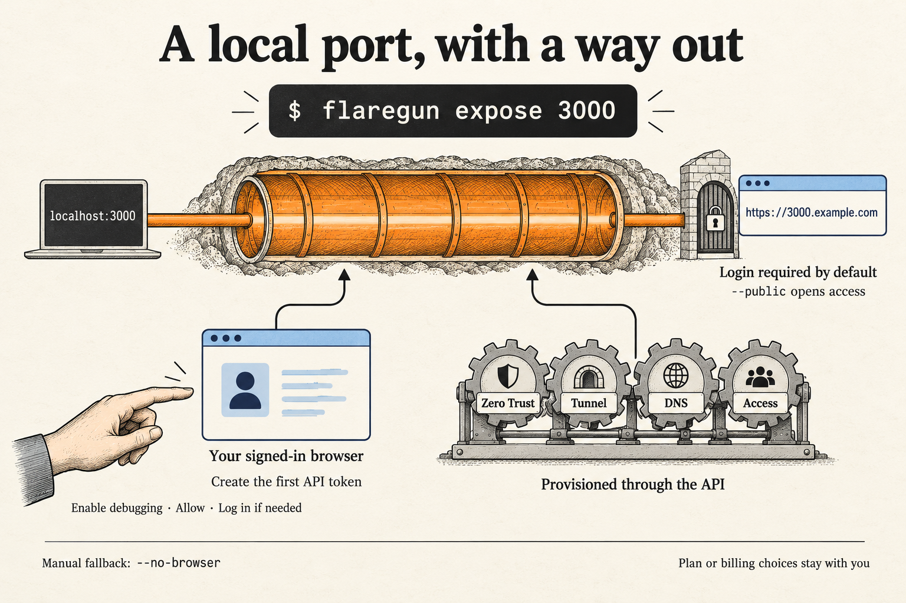
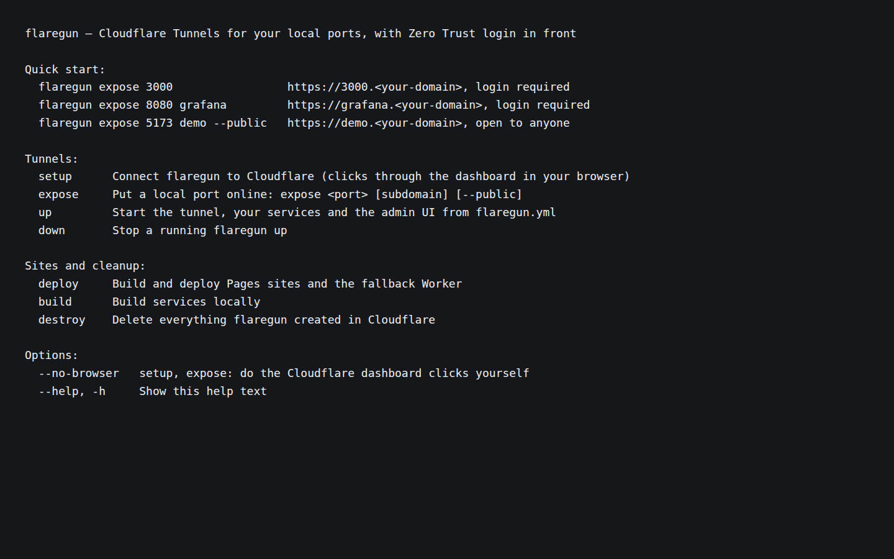

# TL;DR

Flaregun now puts a local port behind Cloudflare Zero Trust with `flaregun expose 3000`, running setup when needed and starting or updating the tunnel. Setup can click through token creation in your signed-in browser, then use the API for provisioning, with manual fallbacks where needed.

What changed, why, and where to review

The requested facelift focuses the existing CLI on the shortest path from a running local app to a protected address on your domain. Help and the [README](../../../README.md) lead with `expose`; Pages, Workers, resources and the admin UI remain available.

`expose` adds a port-only service to `flaregun.yml`. It runs setup in an unconfigured folder, then starts `up` in the foreground, or sends the new configuration to an existing `up`. Protected access is the default for a new entry; `--public` explicitly opens it to anyone. The local app must already serve the port.

Setup connects to a supported Chrome-family browser through a small built-in DevTools client. The person enables remote debugging and allows the connection. Flaregun opens its own tab, waits for login or a human check when necessary, and clicks through the Create Additional Tokens template. That temporary token creates Flaregun's token through the API and is then deleted; failure to delete it produces cleanup instructions. Provisioning reuses existing resources where possible, selects a sole account/domain automatically, creates Zero Trust and a login method when needed, and creates or reuses a tunnel. Required plan choices stay with the person.

Review [the expose handler](../../../src/expose/index.ts), [setup](../../../src/setup/index.ts), [browser handoff](../../../src/setup/dashboard.ts), and [dashboard automation](../../../src/browser/cloudflare-dashboard.ts) first. The area details below identify the other entry points.

The latest gates report applies to product HEAD `a938c68`: type checks, core tests, browser fixture tests and CLI smoke checks passed; UI build and tests also passed, with their earlier evidence retained because the gate fixes did not touch UI code. The gates session reviewed every changed source file and resolved the static-check findings. The independent evaluation judged the CLI experience good. Neither phase verified a live Cloudflare account or the user's real Brave browser. This is ready for internal human testing with those limits, not evidence of a successful live provisioning run.

## Screenshots

The visible facelift is in CLI help and setup. The screenshot below renders actual CLI help output in a browser for readability; it is not a Cloudflare dashboard capture.

## Expose a local port

`flaregun expose <port> [subdomain]` saves an address and starts or updates the tunnel, with login required by default for new entries.

Configuration and running services

The subdomain defaults to the port number. Configuration edits preserve existing comments and layout; matching entries are reused and conflicting ports or names produce guidance. Repeating an existing entry keeps its current access setting. A port-only service gets tunnel ingress without starting a child process. Services with a command retain process supervision.

The running instance's admin port is recorded alongside its PID so `expose` can apply configuration immediately. Existing PID files still load. Hot reload handles port-only services without claiming to restart a process.

Review [configuration validation](../../../src/config/index.ts), [orchestration](../../../src/orchestrate/index.ts), [hot reload](../../../src/sync/hot-reload.ts), and [expose tests](../../../tests/expose.test.ts). [CLI dispatch](../../../src/cli/commands.ts) groups tunnel commands first and accepts help after a command name.

## Browser-assisted setup

Setup uses the person's browser session for token creation and the Cloudflare API for the rest, with instructions to finish manually if automation cannot continue.

Browser control, credentials and Zero Trust

Discovery supports Chrome, Brave, Edge, Chromium and Vivaldi on Linux and macOS, including a profile override through `FLAREGUN_BROWSER_PROFILE`. It reads `DevToolsActivePort`, validates its format, and connects over loopback. No browser automation dependency was added: [discovery](../../../src/browser/discovery.ts) and [the DevTools client](../../../src/browser/cdp.ts) implement the connection directly.

`--no-browser` selects manual dashboard steps. Failed automation also leaves instructions and a token-paste path. Token-page automation depends on Cloudflare's current button labels; the [plan record](plan.md) retains that open hypothesis. When API onboarding cannot finish, setup opens Zero Trust and waits for the person to choose the team and plan; it never clicks plan or billing pages.

[Token policies](../../../src/setup/token.ts) select permissions by API name. They cover Flaregun's existing stack features and use all-account/all-zone resource scopes, rather than restricting the token to the selected domain. Missing permission groups produce a warning. [Zero Trust setup](../../../src/setup/zero-trust.ts) keeps an existing login method or adds email One-time PIN. Setup preserves an existing YAML configuration and saves credentials in `.env` with owner-only permissions, including when updating an older file.

## Starting the tunnel

When `cloudflared` is missing, interactive startup offers to download a local copy.

Installation and remaining limitation

[The installer](../../../src/tunnel/cloudflared.ts) checks PATH and Flaregun's local bin directory before offering a download from Cloudflare's GitHub releases. Downloads support Linux and macOS on x64 and arm64; other environments get installation guidance. A noninteractive startup cannot accept the download prompt. The download has no checksum verification; the gates report explicitly accepts this debt.

## Work, evaluation and gates evidence

Contributions, fixes and verification history

**Work pass 1 — implemented.** No report was recorded. The delivered diff contains the browser-assisted setup, tunnel-first CLI, `expose`, port-only services, cloudflared installer, documentation and tests described above. There is no separate work-phase verification account to preserve.

**Evaluation pass 1 — good.** The evaluator judged the CLI experience against the request, reviewing help, the first-run `expose` transcript, fallback instructions and README. Playwright Chromium ran the fake-dashboard browser suite: 14 passed. Discovery support for Brave, the user's default browser, was checked. The evaluator made no code changes and performed no security review. Live Cloudflare and real Brave takeover remained unverified. This judgment preceded the gate fixes below; no repeat evaluation after those fixes was reported.

**Gates pass 1 — passed, high risk.** The closing gates report identifies final product HEAD `a938c68` and reports:

- Root and admin UI type checks passed, repeated after each fix. Core tests passed with 660+ passing, 4 skipped and no failures, repeated after each fix and including the added regressions.
- Admin UI build and all 87 UI tests passed. The gate fixes did not touch UI code, so those checks were not repeated after the fixes.
- Browser automation against the fake dashboard passed all 14 tests using Playwright Chromium. This does not exercise the live dashboard or a signed-in personal browser.
- CLI smoke initially found `expose --help` failing. Commit `fbcaf54` fixed command-position help and added a regression test; the rerun passed.
- Commit `a938c68` made an existing `.env` owner-only when setup writes secrets and corrected hot-reload messages for services without a process. Both fixes have tests.
- The gates reviewer read every changed source file and checked token cleanup, token output, loopback browser connections, port-file validation, browser consent, existing configuration and PID compatibility, and port-only services.
- Static checks initially raised 24 DevSkim/Gitleaks findings. Each was reviewed and ignored with a reason for the fabricated test token, constant timer delays or intentional CLI output in [the ignore record](../../static-checks-ignore.toml). The rescan had no open findings. Checkov had no open findings; Bandit, Gosec, PMD, Psalm, Trivy and Zizmor had no applicable files and were skipped.

[The saved initial gate output](gate-check-results.md) is historical: it still shows the help and security failures before their resolution. The later closing gates report supplied with this release assignment supersedes those failures. No separate production CLI build was run because the CLI runs from Bun source; the admin UI build passed. Live Cloudflare API/dashboard behavior and actual Brave takeover remain for internal human testing.

**Release summary step.** Product files were left as the gates delivered them. The infographic was generated with the native image tool and inspected for readability; its [prompt](implementation_summary/infographic-prompt.txt) is saved beside it. The runner executed `bun src/cli/index.ts --help` successfully (exit 0, no Cloudflare contact) and captured its exact output in a browser. That screenshot was copied from browser evidence and inspected for readability. This is documentation evidence, not a repeat end-to-end test.

