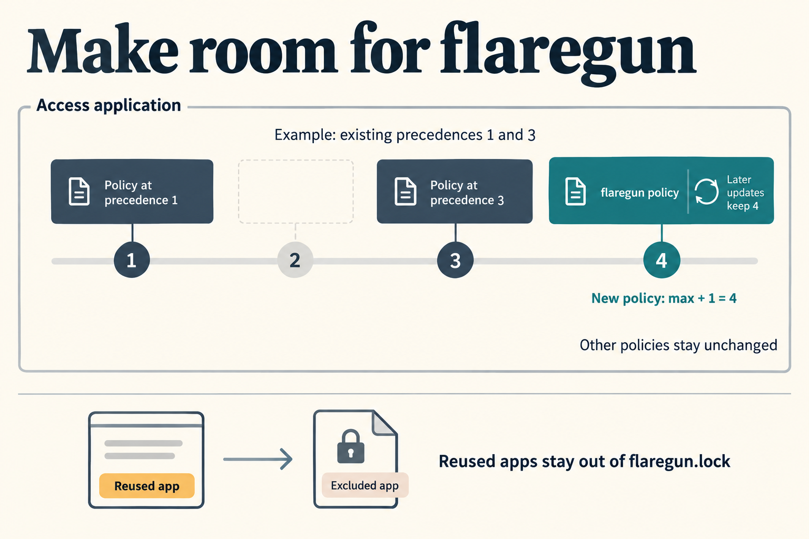

**TL;DR:** Fix `flaregun up` failing with Cloudflare error 12130 by assigning new Access policies the highest existing precedence plus one and preserving precedence on updates. Reuse existing Access apps without claiming them in the lock when they do not pass flaregun's ownership check.

What changed, verification, and review guide

The [request](input/0001-task.md) reports `flaregun up` failing during `access-policies` with “policy precedences must be unique,” possibly after another machine had configured the same domain. Previously, flaregun reused a matching Access app but created its policy at precedence 1, which could already be occupied. The exact app involved in the user's failure remains unconfirmed.

New policies now use `max(0, existing precedences) + 1`; updates keep the matched policy's precedence. Policies are matched by flaregun's policy name, and policies with other names remain unchanged. Apps still match by domain.

The related lock change prevents a reused app from becoming a deletion target merely because its domain matches. An existing app stays in the lock only when its name equals the flaregun key and the lock already points to its ID. Otherwise sync removes that key while processing the desired app. Newly created apps are still recorded normally.

Review [Access sync](../../../src/sync/access.ts), the [mocked Cloudflare client](../../../tests/helpers/mock-client.ts), the [regression tests](../../../tests/sync/access.test.ts), and the [State Management documentation](../../../README.md). Gates passed type checks and the core suite, and reviewed lock and destroy consumers. The phase evidence below distinguishes the implementation run from the later gate checks.

Ready for internal human testing. No live Cloudflare account was exercised. This addresses the reported collision; it does not establish which existing app caused it. A flaregun policy added to an app excluded from the lock remains after the service is removed. An app whose lock entry is lost, or whose name changes, is also treated as unowned. Old lock entries are cleared when sync encounters the matching desired app; this change does not add a separate ownership audit to `destroy` or to removal of already-absent services.

There is no screen change, so no application screenshots are included. The infographic illustrates the sync behavior rather than a captured live result. It was generated with the built-in image tool using the saved [prompt](implementation_summary/infographic-prompt.txt).

### Accumulated phase reports

**Work pass 1 — implemented, commit `96767a6`.** Delivered precedence allocation, preservation on update, and conservative lock ownership. The shared mock now stores precedence and rejects duplicates. Four regression tests cover allocation after existing policies, preserving precedence on update, excluding reused apps from the lock, and clearing a stale entry before a later service removal. The work report says all four fail without the fix. Direct `bunx tsc --noEmit` passed and `bun test tests` reported 670 passing tests with no failures, excluding browser tests. These commands were run directly after runner requests timed out waiting for Factory memory. No live Cloudflare test was performed. The work report identified retained policies on reused apps and conservative treatment of renamed apps or lost lock entries as limits.

**Gates pass 1 — passed.** Gates judged the change high risk because lock membership determines which live apps removal and `destroy` delete. Root and admin UI type checks passed. Focused sync tests passed: 136 passed, zero failed. The final full core run passed: 666 passed, four browser tests skipped, zero failed. Its first attempt encountered temporary-directory `ENOENT` failures; a rerun passed without source changes. These are separate results from the earlier work run, not additional coverage inferred from its count.

Gates read the complete Access sync, mock, regression tests, and the lock and destroy consumers, and reported no defects. Review ranking reported access.ts 37.7/100, mock 20.4/100 and tests 14.5/100, with no smells. Gates also added the README explanation in commit `41b9a93`. That documentation-only change followed the code checks; tests were not repeated for it, and the earlier checks still apply to the unchanged code. See the [recorded gate results](gate-check-results.md) and [check selection and reasons](gate-checks.json).

Build was omitted because dependencies, build configuration and UI code did not change. Live smoke testing was omitted because the affected path needs a Cloudflare account with a conflicting app. A separate security check was omitted: gates reported no changes to auth mechanisms, secrets, input parsing, shell execution or dependencies; review did include deletion ownership. Lint and formatting were not run because no saved operations existed. Gates retained the same uncertainties: no live Cloudflare verification, policies remaining on reused apps, and domain-only app matching.

No separate Evaluation phase was enabled or reported. The release-summary step inspected the final diff and records and added only this summary and its illustration; it did not repeat the code checks.

### Access policy precedence

New policies take a free number after the existing policies; updates retain their number.

How the policy fix works

A hard-coded precedence of 1 could collide with a policy already attached to a reused Access app. Sync now lists the app's policies and allocates one more than the largest precedence, using zero as the baseline for an empty list. For example, existing precedences 1 and 3 produce a new precedence of 4. Selector or decision updates keep the matched policy's existing precedence. Other policy names are left alone.

The mock rejects duplicate precedence on creates and updates. Regression coverage exercises both creation alongside existing policies and updates to flaregun's policy.

### Reused Access apps and cleanup

Reusing an app no longer automatically adds it to flaregun's deletion inventory.

How the lock change works

For each desired hostname, sync reuses the matching app. It retains an existing lock entry only when both the app's name matches the flaregun key and its ID matches the lock entry. Otherwise it removes that key. This lets a successful sync clear a prior version's incorrect lock entry while the service is still desired, protecting the reused app from subsequent service removal, switching to public, or `destroy` through that lock.

The tests verify reuse without recording ownership, then clear an old entry during sync and remove the service in a later sync without deleting the app. The README documents the reuse behavior. Policies added to these apps are not separately tracked for cleanup.

